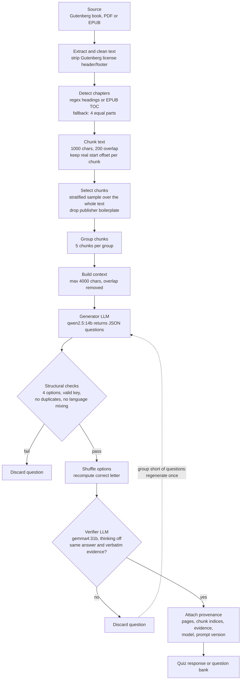
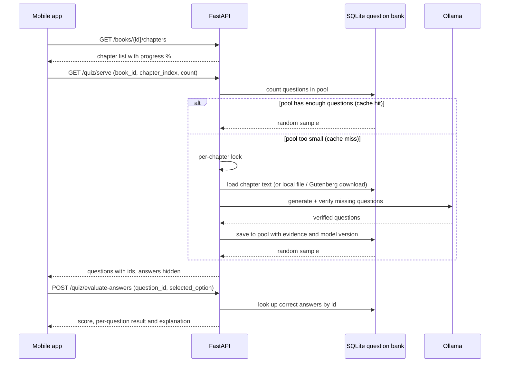

# Context RAG - Mobile & Web Quiz API

A backend service that generates and grades multiple-choice quizzes from **Project Gutenberg (79,000+ books)** and **user-uploaded PDF/EPUB documents**, using local LLMs served by Ollama.

---

## How It Works

### Quiz generation pipeline

Every quiz endpoint goes through the same pipeline: the source text is split into chunks, a representative sample is grouped into LLM-sized contexts, and each generated question is validated, shuffled and independently verified against the text before it is returned.



Key points:

- **Coverage:** chunks are sampled from evenly spaced slices of the text, so the beginning, middle and end of a book are always represented.
- **Answer-position bias:** the LLM tends to put the correct answer in A or B, so options are shuffled after generation.
- **Grounding:** a second model answers each question using only the text and must quote verbatim evidence. If it picks a different option, cannot quote the text, or the verification call fails, the question is dropped (fail closed).

### Mobile question bank flow

Mobile clients do not generate quizzes on demand. They read from a persistent per-chapter question pool, and answers are graded on the server so the client never sees the correct option.



---

## Quick Start

### 1. Start the API server
```bash
# Activate the virtual environment
source venv/bin/activate

# Key for admin endpoints (/books/import, /quiz/populate). If unset, these endpoints are disabled.
export ADMIN_API_KEY="a-long-random-value"

# Grounding verification (on by default): each question is checked against the text by a
# second LLM call; if the verifier picks a different option or cannot quote verbatim
# evidence from the text, the question is dropped.
# The default verifier is gemma4:31b with thinking off. Download it first (~20 GB):
ollama pull gemma4:31b
# The generator (qwen2.5:14b, 9 GB) and the verifier together use about 29 GB of RAM.
# export QUIZ_VERIFY_ANSWERS=0              # disable verification (faster, bad questions may get through)
# export QUIZ_VERIFY_MODEL=qwen2.5:14b      # verify with the generator if gemma is missing or RAM is short (weaker)
# export QUIZ_VERIFY_THINK=1                # enable thinking (about 10x slower)
# Whether the verifier model is installed is shown in GET /api/v1/health -> verify_model_installed.
#
# To measure the verifier on the labeled set (evals/verifier_eval.json, 47 questions):
# QUIZ_VERIFY_MODEL=gemma4:31b QUIZ_VERIFY_THINK=0 python scripts/eval_verifier.py --out result.json

# Start the FastAPI server (port 8000)
uvicorn api.main:app --host 0.0.0.0 --port 8000 --reload
```

- **Swagger UI (interactive testing):** [http://localhost:8000/docs](http://localhost:8000/docs)
- **ReDoc documentation:** [http://localhost:8000/redoc](http://localhost:8000/redoc)
- **Postman collection:** import `Context_RAG_Quiz_API.postman_collection.json` from the project root into Postman.

### 2. Start the Streamlit web panel (optional)
```bash
streamlit run ui/app.py --server.port 8501
```
Web UI: [http://localhost:8501](http://localhost:8501)

---

## Notes for Mobile Developers

When connecting to your local machine from an emulator or a physical device:
- **Android emulator:** `http://10.0.2.2:8000`
- **iOS simulator:** `http://localhost:8000` or `http://127.0.0.1:8000`
- **Physical device (Wi-Fi):** your computer's local IP address (e.g. `http://192.168.1.XX:8000`)
- **CORS:** open to all origins, methods and headers by default.

---

## API Endpoint Reference

All endpoints take `difficulty` as `easy`, `medium` (default) or `hard`. Any other value returns `422`.

### 1. System Status
```http
GET /api/v1/health
```
Returns the Ollama connection status, the active LLM (`qwen2.5:14b`) and embedding (`bge-m3`) models, the number of books in the catalog, and whether the verifier model (`verify_model`, default `gemma4:31b`) is installed (`verify_model_installed`). If the verifier is missing, `status` is `degraded`.

---

### 2. Book Catalog & Search

#### Search books
```http
GET /api/v1/books/search?q={query}&limit={limit}
```
*Example:* `GET /api/v1/books/search?q=Sherlock Holmes&limit=10`
*Response:*
```json
{
  "query": "Sherlock Holmes",
  "total": 5,
  "books": [
    {
      "book_id": "1661",
      "title": "The Adventures of Sherlock Holmes",
      "author": "Arthur Conan Doyle",
      "subjects": "Detective and mystery stories",
      "bookshelves": "Detective Fiction",
      "language": "en",
      "is_cached_locally": true
    }
  ]
}
```

#### Book details
```http
GET /api/v1/books/{book_id}
```
*Example:* `GET /api/v1/books/1661`

#### Book chapters
```http
GET /api/v1/books/{book_id}/chapters
```
Returns every chapter with its title, size and position in the book (`progress_percent`). Chapters from the question bank are used if the book has been imported; otherwise they are detected from the Gutenberg text.

---

### 3. Quiz Generation

#### Create a quiz (RESTful)
```http
POST /api/v1/quizzes
Content-Type: application/json
```
*Body:*
```json
{
  "source": { "type": "book", "book_id": "1661", "chapter_index": 1 },
  "question_count": 5,
  "difficulty": "medium"
}
```
Title and author are resolved from the catalog. `chapter_index` is optional; without it, questions are drawn from the whole book. Returns `201 Created` with the quiz and an `id`.

#### Generate a quiz from a book
```http
POST /api/v1/quiz/generate-from-book
Content-Type: application/json
```
*Body:*
```json
{
  "book_id": "1661",
  "title": "The Adventures of Sherlock Holmes",
  "author": "Arthur Conan Doyle",
  "num_questions": 5,
  "difficulty": "medium",
  "question_type": "multiple_choice"
}
```
*Response:*
```json
{
  "source_type": "book",
  "identifier": "1661",
  "title": "The Adventures of Sherlock Holmes",
  "author": "Arthur Conan Doyle",
  "total_questions": 5,
  "questions": [
    {
      "question": "On which street do Holmes and Watson live?",
      "options": [
        "A) Baker Street 221B",
        "B) Oxford Street 12",
        "C) Fleet Street 4",
        "D) Abbey Road 10"
      ],
      "correct_answer": "A",
      "explanation": "Holmes and Watson live at 221B Baker Street.",
      "source_pages": []
    }
  ]
}
```

#### Generate a quiz from a PDF
```http
POST /api/v1/quiz/generate-from-pdf
Content-Type: multipart/form-data
```
*Form fields:*
- `file`: PDF file (binary, max 50 MB)
- `num_questions`: int (default 5, between 1 and 10)
- `difficulty`: string (`easy` | `medium` | `hard`, default `medium`)
- `question_type`: string (`multiple_choice`)

#### Generate a quiz from an EPUB
```http
POST /api/v1/quiz/generate-from-epub
Content-Type: multipart/form-data
```
*Form fields:*
- `file`: EPUB file (binary, max 50 MB)
- `num_questions`: int (default 5, between 1 and 10)
- `difficulty`: string (`easy` | `medium` | `hard`, default `medium`)
- `question_type`: string (`multiple_choice`)

---

### 4. Headless Question Bank & Mobile Quiz Service (Cache & Anti-Cheat)

A quiz engine for mobile apps with a persistent question pool per chapter (sub-millisecond cache hits) and server-side grading. It stores no user data.

> For the detailed mobile integration guide, see [docs/question_bank_api.md](docs/question_bank_api.md).

#### Import a book and its chapters
```http
POST /api/v1/books/import
Content-Type: multipart/form-data
X-Admin-Key: {ADMIN_API_KEY}
```
Reads an EPUB or PDF, splits it into chapters using the embedded table of contents (TOC) and pages, and stores it. **Admin endpoint:** requires `X-Admin-Key`.
When the same book is imported again, the question pool of every chapter whose text changed is deleted, and chapters that no longer exist are removed, so questions never end up attached to the wrong chapter (which would spoil later chapters).

#### Get a chapter quiz (cache hit / on demand)
```http
GET /api/v1/quiz/serve?book_id={book_id}&chapter_index={chapter_index}&count=5&difficulty=medium&hide_answers=true
```
- If the pool has enough questions: returns a random sample from the pool immediately (`cache_hit: true`).
- If the pool is too small: generates questions from the chapter text with the LLM and saves them to the pool (`cache_hit: false`).
- `hide_answers=true`: correct options and explanations are not sent to the client (`correct_answer: null`).
- `hide_answers=false` is only accepted with a valid `X-Admin-Key` header; otherwise the response is `403`.

#### Grade answers by question ID (anti-cheat)
```http
POST /api/v1/quiz/evaluate-answers
Content-Type: application/json
```
```json
{
  "answers": [
    {
      "question_id": 101,
      "selected_option": "A) Baker Street 221B"
    }
  ]
}
```
The mobile client sends only the question ID and the selected option, without knowing the correct answer; the server checks the answers in the database and computes the score.

#### Pre-populate a question pool
```http
POST /api/v1/quiz/populate?book_id={book_id}&chapter_index={chapter_index}&target_count=15&difficulty=medium
X-Admin-Key: {ADMIN_API_KEY}
```
Fills a chapter's question pool in the background (admin / cron) up to `target_count` questions; if the pool is partially filled, only the missing questions are generated. **Admin endpoint:** requires `X-Admin-Key`.

---

### 5. Backward Compatibility: Grade Quiz Answers

```http
POST /api/v1/quiz/evaluate
Content-Type: application/json
```
Scores the options submitted by the user against the original quiz list sent in the same request.

---

## Testing with Postman

1. Open Postman.
2. Click **Import** in the top left.
3. Select `Context_RAG_Quiz_API.postman_collection.json` from the project directory.
4. The collection variable `baseUrl` defaults to `http://localhost:8000`.
5. You can now try every request in the collection's 6 categories (search, EPUB/PDF import, chapter quiz, anti-cheat grading, etc.).
