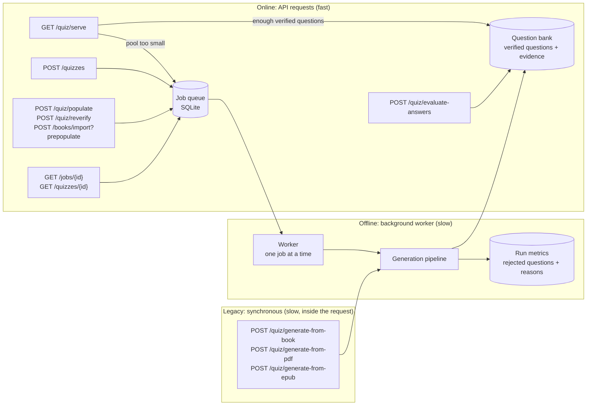
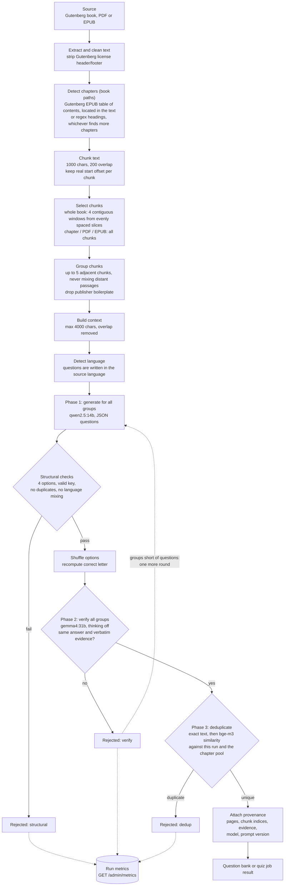
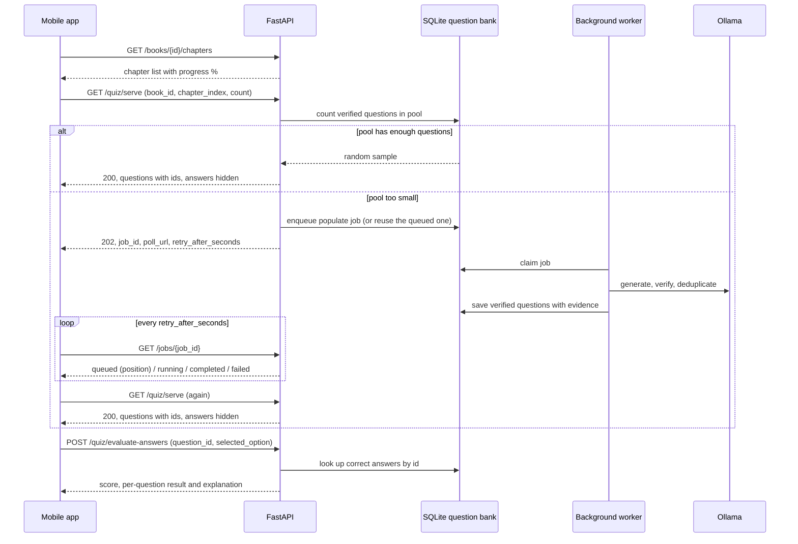

# Context RAG - Mobile & Web Quiz API

A backend service that generates and grades multiple-choice quizzes from **Project Gutenberg (79,000+ books)** and **user-uploaded PDF/EPUB documents**, using local LLMs served by Ollama.

---

## How It Works

### Architecture

Generation and serving are separated. LLM generation is slow (tens of seconds per call on a local GPU), so the main endpoints never run it inside an HTTP request: requests that need new questions enqueue a job, and a single background worker processes the queue in order (Ollama runs one request at a time on a single GPU anyway). These endpoints only read from the question bank or report job status.

The legacy endpoints `POST /quiz/generate-from-book`, `/generate-from-pdf` and `/generate-from-epub` are the exception: they are kept for backward compatibility and still generate synchronously, so a request can take several minutes and runs alongside the worker on the same Ollama instance. New clients should use `POST /quizzes` (books) or the question bank flow instead.



- Repeated requests for the same chapter attach to the same queued job instead of generating twice.
- Jobs survive restarts: on startup, jobs that were running are queued again.
- Only verified questions (with evidence) are served. Questions generated before verification existed can be checked with `POST /quiz/reverify`.

### Quiz generation pipeline



Key points:

- **Coherent context:** each LLM context is a contiguous passage. Sampling single chunks from all over the book and gluing them together made the model mix unrelated scenes.
- **Coverage:** windows come from evenly spaced slices of the text, so the beginning, middle and end of a book are always represented.
- **Answer-position bias:** the LLM tends to put the correct answer in A or B, so options are shuffled after generation.
- **Grounding:** a second model from a different family answers each question using only the text and must quote verbatim evidence. If it picks a different option, cannot quote the text, or the verification call fails, the question is dropped (fail closed).
- **Duplicates:** a question counts as a duplicate if question + answer similarity is at least 0.85, or question-only similarity is at least 0.95 (same question with a conflicting answer).
- **Phases:** each round generates for all groups, then verifies all, then deduplicates, so Ollama switches models once per round instead of once per group.
- **Chapters:** Gutenberg EPUB tables of contents give real chapter titles; their boundaries are located in the plain text so character offsets, chunks and progress stay consistent. Captions merged into titles and container headings ("BOOK ONE") are handled. On the 30 locally cached books this improved detection on 7 books and made none worse.

### Mobile question bank flow

Mobile clients never wait for generation inside a request. If a chapter's pool is too small, the API answers `202 Accepted` with a job id, the app polls the job, and requests the quiz again when the job is done. Answers are graded on the server, so the client never sees the correct option.



---

## Quick Start

### 1. Start the API server
```bash
# Activate the virtual environment
source venv/bin/activate

# Key for admin endpoints (/books/import, /quiz/populate). If unset, these endpoints are disabled.
export ADMIN_API_KEY="a-long-random-value"

# Grounding verification (on by default): each question is checked against the text by a
# second LLM call; if the verifier picks a different option or cannot quote verbatim
# evidence from the text, the question is dropped.
# The default verifier is gemma4:31b with thinking off. Download it first (~20 GB):
ollama pull gemma4:31b
# The generator (qwen2.5:14b, 9 GB) and the verifier together use about 29 GB of RAM.
# export QUIZ_VERIFY_ANSWERS=0              # disable verification (faster, bad questions may get through)
# export QUIZ_VERIFY_MODEL=qwen2.5:14b      # verify with the generator if gemma is missing or RAM is short (weaker)
# export QUIZ_VERIFY_THINK=1                # enable thinking (about 10x slower)
# Whether the verifier model is installed is shown in GET /api/v1/health -> verify_model_installed.
#
# To measure the verifier on the labeled set (evals/verifier_eval.json, 47 questions):
# QUIZ_VERIFY_MODEL=gemma4:31b QUIZ_VERIFY_THINK=0 python scripts/eval_verifier.py --out result.json
#
# Duplicate filtering uses bge-m3 (already used as the embedding model):
# export QUIZ_DEDUP_THRESHOLD=0.85           # question + answer similarity
# export QUIZ_DEDUP_QUESTION_THRESHOLD=0.95  # question-only similarity (same question, conflicting answer)
#
# The background generation worker starts with the API. To run the API without it:
# export JOB_WORKER_ENABLED=0
#
# Chapter detection downloads each Gutenberg book's EPUB once (cached in data/books/{id}.epub)
# to read its table of contents.

# Start the FastAPI server (port 8000)
uvicorn api.main:app --host 0.0.0.0 --port 8000 --reload
```

- **Swagger UI (interactive testing):** [http://localhost:8000/docs](http://localhost:8000/docs)
- **ReDoc documentation:** [http://localhost:8000/redoc](http://localhost:8000/redoc)
- **Postman collection:** import `Context_RAG_Quiz_API.postman_collection.json` from the project root into Postman.

### 2. Start the Streamlit web panel (optional)
```bash
streamlit run ui/app.py --server.port 8501
```
Web UI: [http://localhost:8501](http://localhost:8501)

---

## Notes for Mobile Developers

When connecting to your local machine from an emulator or a physical device:
- **Android emulator:** `http://10.0.2.2:8000`
- **iOS simulator:** `http://localhost:8000` or `http://127.0.0.1:8000`
- **Physical device (Wi-Fi):** your computer's local IP address (e.g. `http://192.168.1.XX:8000`)
- **CORS:** open to all origins, methods and headers by default.

---

## API Endpoint Reference

All endpoints take `difficulty` as `easy`, `medium` (default) or `hard`. Any other value returns `422`.

### 1. System Status
```http
GET /api/v1/health
```
Returns the Ollama connection status, the active LLM (`qwen2.5:14b`) and embedding (`bge-m3`) models, the number of books in the catalog, and whether the verifier model (`verify_model`, default `gemma4:31b`) is installed (`verify_model_installed`). If the verifier is missing, `status` is `degraded`.

---

### 2. Book Catalog & Search

#### Search books
```http
GET /api/v1/books/search?q={query}&limit={limit}
```
*Example:* `GET /api/v1/books/search?q=Sherlock Holmes&limit=10`
*Response:*
```json
{
  "query": "Sherlock Holmes",
  "total": 5,
  "books": [
    {
      "book_id": "1661",
      "title": "The Adventures of Sherlock Holmes",
      "author": "Arthur Conan Doyle",
      "subjects": "Detective and mystery stories",
      "bookshelves": "Detective Fiction",
      "language": "en",
      "is_cached_locally": true
    }
  ]
}
```

#### Book details
```http
GET /api/v1/books/{book_id}
```
*Example:* `GET /api/v1/books/1661`

#### Book chapters
```http
GET /api/v1/books/{book_id}/chapters
```
Returns every chapter with its title, size and position in the book (`progress_percent`). Chapters from the question bank are used if the book has been imported; otherwise they are detected from the Gutenberg text.

---

### 3. Quiz Generation

#### Create a quiz (RESTful, asynchronous)
```http
POST /api/v1/quizzes
Content-Type: application/json
```
*Body:*
```json
{
  "source": { "type": "book", "book_id": "1661", "chapter_index": 1 },
  "question_count": 5,
  "difficulty": "medium"
}
```
Title and author are resolved from the catalog. `chapter_index` is optional; without it, questions are drawn from the whole book. An invalid `chapter_index` returns `400` immediately.

Generation is queued and the response is `202 Accepted`:
```json
{ "id": "quiz_3f9a1c2b7d4e5f60", "status": "queued", "poll_url": "/api/v1/quizzes/quiz_3f9a1c2b7d4e5f60",
  "queue_position": 0, "retry_after_seconds": 15 }
```

```http
GET /api/v1/quizzes/{id}
```
- `202` while the job is `queued` or `running`
- `200` with `status: "completed"` and the questions (including answers)
- `200` with `status: "failed"` and an `error` message

#### Legacy synchronous endpoints

The three endpoints below run generation inside the request and answer only when the quiz is ready (often several minutes with verification on). Set a long client timeout. Generated questions are not stored in the question bank.

#### Generate a quiz from a book
```http
POST /api/v1/quiz/generate-from-book
Content-Type: application/json
```
*Body:*
```json
{
  "book_id": "1661",
  "title": "The Adventures of Sherlock Holmes",
  "author": "Arthur Conan Doyle",
  "num_questions": 5,
  "difficulty": "medium",
  "question_type": "multiple_choice"
}
```
*Response:*
```json
{
  "source_type": "book",
  "identifier": "1661",
  "title": "The Adventures of Sherlock Holmes",
  "author": "Arthur Conan Doyle",
  "total_questions": 5,
  "questions": [
    {
      "question": "On which street do Holmes and Watson live?",
      "options": [
        "A) Baker Street 221B",
        "B) Oxford Street 12",
        "C) Fleet Street 4",
        "D) Abbey Road 10"
      ],
      "correct_answer": "A",
      "explanation": "Holmes and Watson live at 221B Baker Street.",
      "source_pages": []
    }
  ]
}
```

#### Generate a quiz from a PDF
```http
POST /api/v1/quiz/generate-from-pdf
Content-Type: multipart/form-data
```
*Form fields:*
- `file`: PDF file (binary, max 50 MB)
- `num_questions`: int (default 5, between 1 and 10)
- `difficulty`: string (`easy` | `medium` | `hard`, default `medium`)
- `question_type`: string (`multiple_choice`)

#### Generate a quiz from an EPUB
```http
POST /api/v1/quiz/generate-from-epub
Content-Type: multipart/form-data
```
*Form fields:*
- `file`: EPUB file (binary, max 50 MB)
- `num_questions`: int (default 5, between 1 and 10)
- `difficulty`: string (`easy` | `medium` | `hard`, default `medium`)
- `question_type`: string (`multiple_choice`)

---

### 4. Headless Question Bank & Mobile Quiz Service (Cache & Anti-Cheat)

A quiz engine for mobile apps with a persistent question pool per chapter (sub-millisecond cache hits) and server-side grading. It stores no user data.

> For the detailed mobile integration guide, see [docs/question_bank_api.md](docs/question_bank_api.md).

#### Import a book and its chapters
```http
POST /api/v1/books/import
Content-Type: multipart/form-data
X-Admin-Key: {ADMIN_API_KEY}
```
Reads an EPUB or PDF, splits it into chapters using the embedded table of contents (TOC) and pages, and stores it. **Admin endpoint:** requires `X-Admin-Key`.
With the form field `prepopulate=true`, a background job is queued for every chapter so the pools are ready before users arrive (`queued_jobs` in the response).
When the same book is imported again, the question pool of every chapter whose text changed is deleted, and chapters that no longer exist are removed, so questions never end up attached to the wrong chapter (which would spoil later chapters).

#### Get a chapter quiz
```http
GET /api/v1/quiz/serve?book_id={book_id}&chapter_index={chapter_index}&count=5&difficulty=medium&hide_answers=true
```
This endpoint never calls the LLM.
- If the pool has enough verified questions: `200` with a random sample (`cache_hit: true`).
- If the pool is too small: a job that fills the pool is queued and the response is `202 Accepted` with a `Retry-After` header:
  ```json
  { "status": "preparing", "job_id": "3f9a1c2b7d4e5f60", "poll_url": "/api/v1/jobs/3f9a1c2b7d4e5f60",
    "retry_after_seconds": 15, "message": "..." }
  ```
  Poll `poll_url` until the job is `completed`, then call `/quiz/serve` again. Concurrent requests for the same chapter share one job.
- `hide_answers=true`: correct options and explanations are not sent to the client (`correct_answer: null`).
- `hide_answers=false` is only accepted with a valid `X-Admin-Key` header; otherwise the response is `403`.

#### Grade answers by question ID (anti-cheat)
```http
POST /api/v1/quiz/evaluate-answers
Content-Type: application/json
```
```json
{
  "answers": [
    {
      "question_id": 101,
      "selected_option": "A) Baker Street 221B"
    }
  ]
}
```
The mobile client sends only the question ID and the selected option, without knowing the correct answer; the server checks the answers in the database and computes the score.

#### Pre-populate a question pool
```http
POST /api/v1/quiz/populate?book_id={book_id}&chapter_index={chapter_index}&target_count=15&difficulty=medium
X-Admin-Key: {ADMIN_API_KEY}
```
Queues a job that fills a chapter's question pool up to `target_count` verified questions; if the pool is partially filled, only the missing questions are generated. Returns `202` with the job (see [Jobs](#jobs)). **Admin endpoint:** requires `X-Admin-Key`.

#### Re-verify old questions
```http
POST /api/v1/quiz/reverify?book_id={book_id}&chapter_index={chapter_index}
X-Admin-Key: {ADMIN_API_KEY}
```
Questions generated before grounding verification existed have no evidence and are not served. This job checks them: for each question, the most relevant chunks of the chapter are retrieved with bge-m3 embeddings and given to the verifier. Questions that pass get their evidence stored and are served again; the others are retired (kept in the database, never served). Both parameters are optional; without them every unverified question is checked. Returns `202` with the job. **Admin endpoint.**

#### Jobs
```http
GET /api/v1/jobs/{job_id}
```
Status of a background job: `queued` (with `queue_position`), `running`, `completed` (with `result`) or `failed` (with `error`). Job kinds: `populate`, `quiz`, `reverify`.

#### Pipeline metrics (admin)
```http
GET /api/v1/admin/metrics?limit=100
GET /api/v1/admin/rejected-questions?stage=verify&limit=100
X-Admin-Key: {ADMIN_API_KEY}
```
`metrics` summarizes the last runs: how many generated questions were rejected at each stage (structural, verify, dedup), average seconds per stage and the most common rejection reasons. `rejected-questions` returns rejected questions with their reason and source text, as candidates for the evaluation set.

---

### 5. Backward Compatibility: Grade Quiz Answers

```http
POST /api/v1/quiz/evaluate
Content-Type: application/json
```
Scores the options submitted by the user against the original quiz list sent in the same request.

---

## Testing with Postman

1. Open Postman.
2. Click **Import** in the top left.
3. Select `Context_RAG_Quiz_API.postman_collection.json` from the project directory.
4. The collection variable `baseUrl` defaults to `http://localhost:8000`.
5. You can now try every request in the collection's 6 categories (search, EPUB/PDF import, chapter quiz, anti-cheat grading, etc.).
