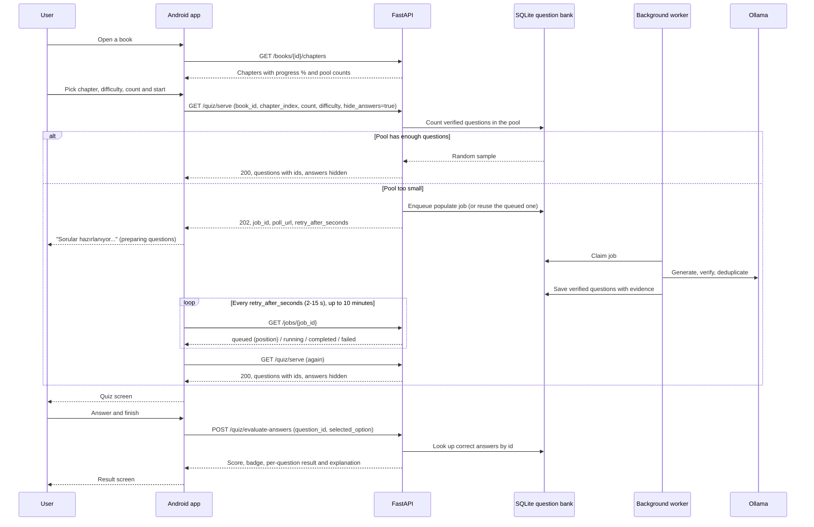

# Context RAG - Android Client

A reference Android client for the Context RAG question bank API, built with Kotlin, Jetpack Compose and Material 3. It shows how a mobile app searches the book catalog, lists a book's chapters, requests a chapter quiz, waits while the server prepares questions, and submits answers for server-side grading.

The app stores no data of its own. All state comes from the API, and the correct answers never reach the device.

---

## Requirements

| | |
|---|---|
| Android Studio | Jellyfish (2023.3) or newer, required by Android Gradle Plugin 8.4; includes the JDK 17 runtime used by Gradle |
| Android | API 26 (Android 8.0) or newer; target and compile SDK 34 |
| Backend | The Context RAG API running and reachable from the device (see the [main README](../README.md)) |

---

## Getting Started

### 1. Start the backend

From the project root:

```bash
source venv/bin/activate
uvicorn api.main:app --host 0.0.0.0 --port 8000
```

Use `--host 0.0.0.0` so a physical device on the same network can reach the server. The background generation worker starts with the API.

### 2. Run the app

1. Open the `android/` directory in Android Studio.
2. Wait for the Gradle sync to finish.
3. Select an emulator (for example Pixel 8, API 34) or a connected device.
4. Run the `app` configuration.

### 3. Point the app at the server

| Where the app runs | Base URL |
|---|---|
| Android emulator | `http://10.0.2.2:8000` (default; the emulator's alias for the host machine) |
| Physical device on Wi-Fi | `http://<your computer's local IP>:8000`, for example `http://192.168.1.45:8000` |

To change the address, open the **Sunucu** (Server) tab, enter the base URL and tap **Bağlan ve Test Et** (Connect and test). The app checks `GET /api/v1/health` and shows the server, model and catalog status.

Cleartext HTTP is allowed (`usesCleartextTraffic`) so the app can talk to a local development server. Use HTTPS and remove this flag for any deployed environment.

---

## Quiz Flow

The server never generates questions inside a request. If a chapter's question pool is too small, it queues a background job and answers `202 Accepted`. The app then shows a preparing state, polls the job, and requests the quiz again when the job is done. Answers are graded on the server, so the client never sees the correct option.



### How the app handles each case

| Situation | What the app does |
|---|---|
| `200` from `serve` | Opens the quiz. A "cache hit" label shows the questions came straight from the pool. |
| `202` from `serve` | Shows the server's message on the start button and polls `GET /jobs/{job_id}`. While the job is queued, it shows how many jobs are ahead. |
| Job `completed` | Calls `serve` again. If the pool is still short (for example, many questions were rejected), it waits for another job, up to 3 `serve` attempts in total. |
| Job `failed` | Stops, stays on the chapter screen and shows the error in a snackbar. |
| No result after 10 minutes | Stops with a timeout message. The job keeps running on the server, so a later attempt usually returns `200`. |
| Network error while polling | Ignores it and keeps polling. |
| Network error on `serve` or grading | Shows the error in a snackbar. |

The polling interval follows the server's `retry_after_seconds`, clamped to 2-15 seconds. The limits are defined in `QuizViewModel` (`MAX_SERVE_ATTEMPTS`, `MAX_PREPARATION_WAIT_MS`).

To avoid the preparing state entirely, fill the pools before users arrive: import the book with `prepopulate=true` or run `POST /api/v1/quiz/populate` (admin endpoints, see the [mobile integration guide](../docs/question_bank_api.md)).

---

## Screens

| Screen | Purpose |
|---|---|
| **Kitaplık** (Library) | Searches the Project Gutenberg catalog (`GET /books/search`). |
| **Book detail** | Lists chapters with reading progress and the number of verified questions in each pool. Lets the user choose difficulty (easy, medium, hard) and question count, then starts the quiz. |
| **Quiz** | One question at a time with navigation between questions. Selected options stay on the device until the quiz is submitted. |
| **Result** | Score, the server's badge, and for each question the user's answer, the correct answer and the explanation. |
| **Sunucu** (Server) | Base URL setting and health status: API, LLM, embedding model and catalog size. |

---

## Project Structure

```
app/src/main/java/com/contextrag/quizapp/
├── MainActivity.kt              Entry point, applies the theme
├── data/
│   ├── ApiClient.kt             OkHttp calls; maps 202 from serve to ServeResult.Preparing
│   └── Models.kt                API models (Gson), Difficulty values, ServeResult, JobStatus
├── viewmodel/
│   └── QuizViewModel.kt         UI state, navigation, quiz start and job polling
└── ui/
    ├── MainScreen.kt            Scaffold, bottom navigation, screen switching
    ├── screens/                 Library, book detail, quiz, result and server screens
    ├── components/              Shared composables
    └── theme/                   Colors, typography, shapes, dynamic color
```

The app uses a single `QuizViewModel` that exposes one `UiState` through a `StateFlow`; screens render that state and call ViewModel functions. One-off messages (errors, "questions ready") go through a `SharedFlow` to a snackbar.

Difficulty is sent to the API as `easy`, `medium` or `hard`; the UI shows the Turkish labels Kolay, Orta and Zor.

---

## Tech Stack

- Kotlin 1.9, Jetpack Compose (BOM 2024.06), Material 3 with dynamic color on Android 12+
- OkHttp 4 for HTTP, Gson for JSON
- Kotlin coroutines and `StateFlow`
- Tests: JUnit 4, OkHttp MockWebServer, `kotlinx-coroutines-test`

---

## Tests

Unit tests cover the API client (including the `202` preparing response and job parsing) and the ViewModel (search, chapters, the full quiz flow, preparation polling, preparation failure and navigation). They run on the JVM and need no device or backend.

```bash
cd android
./gradlew testDebugUnitTest
```

If Gradle cannot find a JDK, use the one bundled with Android Studio:

```bash
JAVA_HOME="/Applications/Android Studio.app/Contents/jbr/Contents/Home" ./gradlew testDebugUnitTest
```
