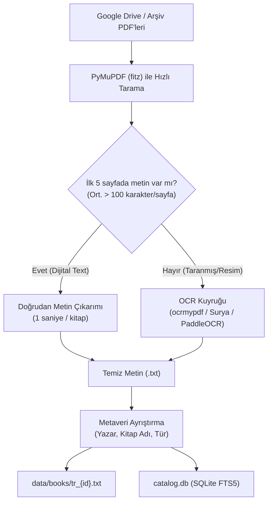

# Türkçe E-Kitap Arşivi (63k+) Dataset Entegrasyon Planı

Bu belge, Google E-Tablolar üzerinde paylaşılan 63.000+ kitaplık dijital kütüphane arşivinin filtrelenip işlenerek **Context-RAG** projesine ikinci bir yerel veri seti (Custom Turkish Book Dataset) olarak entegre edilmesi planını ve teknik detaylarını içerir.

---

## 1. Arşiv ve Kaynak Özeti

- **Kaynak Tablo:** [Kütüphaneler 01-55 (Google E-Tablolar)](https://docs.google.com/spreadsheets/d/1N04dyNeGk0aYOhEHmg_rSu5vnuN5eNZAvXezBfvAbJo/edit?gid=194035655#gid=194035655)
- **Kapsam:** 63.636 satır / PDF (Türk ve dünya edebiyatı, tarih, araştırma-inceleme, felsefe, sosyoloji, süreli yayınlar).
- **Format:** ~55 adet bulut "Kütüphane" klasörüne dağılmış PDF dosyaları.
- **Mevcut Sütunlar:** `Kitap Adı` (genellikle "Yazar - Eser Yayınevi.pdf"), `Boyut` (MB), `Kütüphane` (Örn: Kütüphane 19).

---

## 2. Mimari ve İşleme Aşamaları (Pipeline)

Hepsine körü körüne OCR çalıştırmak haftalar sürecek işlem gücü israfına yol açar. Bu yüzden **2 aşamalı eleme ve dönüştürme (Triage)** kurgulanır:



---

## 3. Adım Adım Uygulama

### Aşama 1: PDF Metin Yoğunluğu Taraması (Triage)

Kitabın orijinal e-kitap çıktısı mı yoksa fotokopi/tarama mı olduğunu saptamak için ilk 5-10 sayfadaki karakter yoğunluğuna bakılır:

```python
import fitz  # PyMuPDF

def inspect_pdf_text_quality(pdf_path: str) -> dict:
    doc = fitz.open(pdf_path)
    total_pages = len(doc)
    sample_pages = min(5, total_pages)
    
    total_chars = sum(len(doc[i].get_text().strip()) for i in range(sample_pages))
    avg_chars = total_chars / max(1, sample_pages)
    
    if avg_chars >= 150:
        return {"status": "digital_text", "pages": total_pages, "sample_avg": avg_chars}
    else:
        return {"status": "scanned_image", "pages": total_pages, "sample_avg": avg_chars}
```

- **`digital_text`:** PyMuPDF ile anında temiz `.txt` dosyasına dönüştürülür (GPU gerekmez, saniyeler sürer).
- **`scanned_image`:** OCR gerektirenler klasörüne ayrılır.

---

### Aşama 2: Taranmış Kitaplar İçin OCR Seçenekleri

| Araç | Türkçe Başarısı | Hız / Donanım | Kullanım Alanı |
| --- | --- | --- | --- |
| **`ocrmypdf` + Tesseract (`tur`)** | Yüksek | CPU tabanlı, çok çekirdek | Standart tek sütunlu romanlar ve düz metinler. |
| **`PaddleOCR` / `RapidOCR`** | Çok Yüksek | CPU/GPU hızlı | Türkçe karakterlerde (`ş, ğ, ı, ö, ç, ü`) ve silik sayfalarda yüksek doğruluk. |
| **`Surya` / `Marker`** | Mükemmel | GPU önerilir | Çok sütunlu dergiler, dipnotlu akademik yayınlar ve başlık ayıklama. |

---

### Aşama 3: Metaveri Ayrıştırma (Başlık & Yazar)

Tablodaki dosya isimleri düzenli bir şablona sahiptir:
- `Sabahattin Ali - Kürk Mantolu Madonna YKY.pdf` $\rightarrow$ Yazar: *Sabahattin Ali*, Başlık: *Kürk Mantolu Madonna*, Yayınevi: *YKY*
- `100 Soruda Türkiye Komünist Partisi.pdf` $\rightarrow$ Başlık: *100 Soruda Türkiye Komünist Partisi*, Yazar: *Bilinmiyor*

Regex kuralları veya yerel LLM (Qwen2.5) batch prompting ile dosya adlarından `title`, `author`, `publisher` alanları ayrıştırılarak `metadata_turkish.csv` oluşturulur.

---

### Aşama 4: Context-RAG ve `catalog.db` Entegrasyonu

Mevcut projemizdeki `data/dataset_cache/catalog.db` veritabanı SQLite FTS5 kullanmaktadır:

```sql
INSERT INTO books (book_id, title, author, subjects, bookshelves, language)
VALUES ('tr_00001', 'Kürk Mantolu Madonna', 'Sabahattin Ali', 'Türk Edebiyatı', 'Roman', 'tr');
```

- **Dosya Depolama:** Kitap metinleri `data/books/tr_00001.txt` formatında kaydedilir.
- **Bölüm Algılama Uyumluluğu:** `src/dataset_search.py` dosyasındaki `CHAPTER_PATTERN` regex kuralımız daha önce Türkçe anahtar kelimelerle güncellenmiştir:
  - `BÖLÜM`, `Bölüm`, `Birinci`, `İkinci`, `Üçüncü`, `Kısım`, `Perde`, `Sahne`, Roma rakamları (`I`, `II`, `III`).
- Bu sayede içeri aktarılan Türkçe metinler için ek hiçbir kod yazılmadan otomatik bölüm tespiti, chunking ve quiz üretimi çalışır.

---

## 4. Kullanıcı Arayüzü (Streamlit) Entegrasyonu

Arayüzde kullanıcının arama yaparken veri setini seçebilmesi için `ui/app.py` üzerine küçük bir filtre eklenebilir:

```python
dataset_source = st.radio(
    "Veri Seti Kaynağı:",
    options=["Tümü", "🇹🇷 Türkçe Kitap Arşivi", "🌍 Gutenberg Klasikleri (İngilizce)"],
    horizontal=True
)
```

---

## 5. Önerilen Uygulama Sırası

1. **Pilot Aşama (100–200 Kitap):**
   Arşivden en popüler 100–200 roman/klasik seçilir.
2. **Otomasyon Scripti:**
   `scripts/import_custom_library.py` scripti ile dijital olanlar ayrılıp `.txt` ve `catalog.db` kayıtları oluşturulur.
3. **Test:**
   Arayüzden Türkçe kitap araması yapılır, bölümler listelenir ve quiz üretimi doğrulanır.
4. **Genişletme:**
   İstenen diğer kütüphaneler ve taranmış eserler kademeli olarak OCR'dan geçirilerek havuza eklenir.
